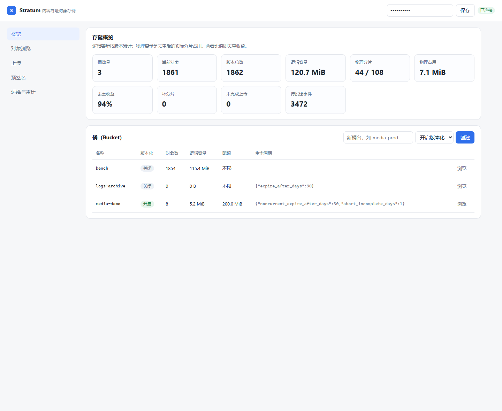
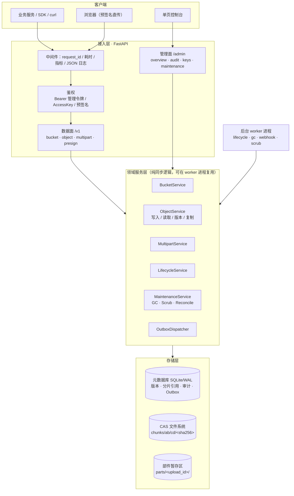
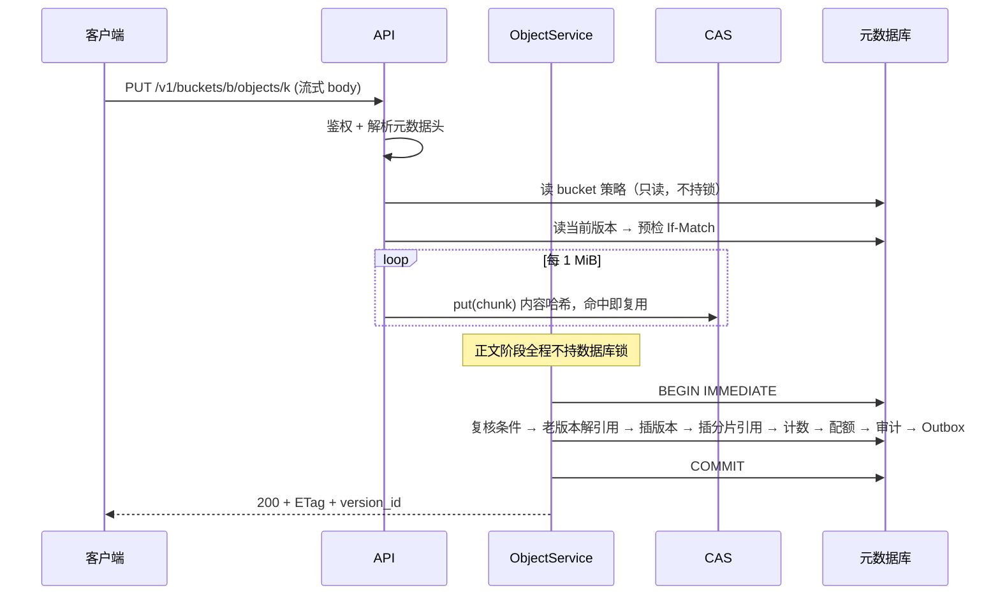
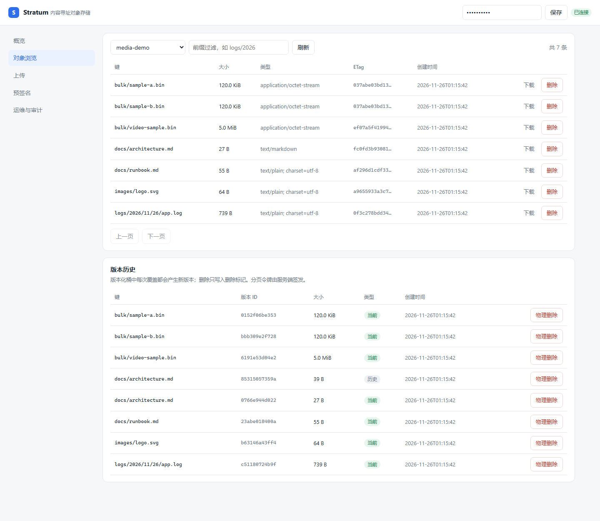

# Stratum · 内容寻址对象存储

> 一个可单机跑起来、也讲得清扩容路径的自建对象存储：**按内容寻址分片、跨对象去重、版本化、分片上传、预签名直传、生命周期治理、后台自愈**。
>
> 面向「同一份文件被多条业务线反复上传、又要能回滚、还要能审计」的私有化存储场景。

```
上传 100 MB 视频两遍 → 磁盘只涨 1 份
覆盖同名文件        → 旧版本仍可取回，删除只是写标记
删掉 1800 个对象    → 读路径立刻 404，磁盘空间由后台按引用计数回收
```



---

## 1. 它解决什么问题

自建对象存储通常不是为了"再做一个 S3"，而是被下面几件事逼出来的：

| 真实痛点 | Stratum 的应对 |
| --- | --- |
| 模型权重、素材、日志被不同业务反复上传同一份，存储成本线性膨胀 | 分片级内容寻址 + 引用计数，跨对象、跨版本、跨桶全局去重 |
| 覆盖写之后想回滚，靠业务侧"另存一份"来兜底 | 桶级版本化，覆盖产生新版本，删除只写删除标记，删标记即恢复 |
| 大文件上传中断就得从头再来 | 分片上传（init/part/complete/abort），部件可乱序、可覆盖、可断点续传 |
| 前端直传要经过业务后端转发，带宽与内存被打爆 | HMAC 预签名 URL，浏览器直连存储，TTL 内有效 |
| 删除后磁盘不降，运维靠人肉清 | 引用计数 + 宽限期 GC，删除是 O(1) 解引用，物理回收异步进行 |
| 磁盘静默损坏，读出来是脏数据但没人发现 | 分片级 SHA-256 巡检，坏分片标记隔离，读路径宁可 500 也不返回错数据 |
| 出了事查不到"谁在什么时候删了什么" | 所有写操作与维护动作同事务落审计，含 request_id |
| 想接事件通知，又怕"对象写成了、消息丢了" | 事务性 Outbox，与业务变更同库同事务，独立 worker 投递 + 退避重试 + 死信 |

---

## 2. 能力矩阵

| 能力 | 实现要点 | 验证 |
| --- | --- | --- |
| 分片去重 | 1 MiB 定长分片，SHA-256 内容寻址，`chunks.refcount` 引用计数 | `test_objects.py::test_chunk_dedup_across_objects` |
| 版本化 | `object_versions` + 部分唯一索引保证「每 key 至多一个 current」 | `test_versioning.py` |
| 删除标记与恢复 | 删除写 marker，删 marker 自动提升最近历史版本 | `test_delete_marker_hides_object` |
| 分片上传 | 部件暂存区 → Complete 时按序切块入 CAS，`upload_id` 复用为 version_id 实现幂等 | `test_multipart.py` |
| Range 读取 | 按分片序列计算字节偏移，支持 `a-b`、`a-`、`-n`、416 | `test_range_requests` |
| 条件写 | `If-Match` / `If-None-Match: *`，事务内二次校验消除 TOCTOU | `test_conditional_writes` |
| 服务端复制 | 仅复制元数据 + 引用，不搬数据 | `test_copy_object_shares_chunks` |
| 配额 | `UPDATE ... WHERE used + delta <= quota` 由写锁做 CAS | `test_quota_enforced` |
| 预签名 | HMAC-SHA256(METHOD, BUCKET, KEY, EXPIRES, AK) | `test_presigned_get` |
| 访问密钥 | 只存 SHA-256 摘要，grants 按 bucket 授予 r/w | `test_auth.py` |
| 生命周期 | 过期、非当前版本裁剪、孤立标记清理、未完成上传中止 | `test_lifecycle.py` |
| 分片 GC | 引用计数 + 宽限期 + 引用复核，先删元数据后删文件 | `test_maintenance.py` |
| 完整性巡检 | 逐分片复算哈希，坏片标记 + 审计 | `test_scrub_detects_corruption` |
| 计数器对账 | 引用计数/用量与权威数据对齐 | `test_reconcile_fixes_*` |
| 事件投递 | Outbox + 租约抢占 + 指数退避 + 死信重放 | `test_webhook.py` |
| 可观测性 | Prometheus 文本指标 + 结构化 JSON 日志 + request_id | `test_overview_and_metrics` |

---

## 3. 架构

### 3.1 分层



### 3.2 一次 PUT 的路径



> 失败语义：如果在上面的 COMMIT 之前任何一步失败，只会留下**没有引用的分片**，由 GC 在宽限期后回收；
> 不会出现「元数据说存在、实际取不到」的坏对象。

### 3.3 模块职责

| 模块 | 路径 | 职责 |
| --- | --- | --- |
| 接入层 | `stratum/api/` | 路由、鉴权依赖、流式桥接、错误码映射 |
| 领域服务 | `stratum/service/` | 业务不变量（版本、引用、配额、幂等、策略） |
| 存储层 | `stratum/storage/` | 元数据 SQL、CAS 原子写、部件暂存 |
| 后台进程 | `stratum/worker.py` | GC / 生命周期 / 巡检 / Outbox 投递 |
| 控制台 | `stratum/web/index.html` | 零构建的单页管理界面 |

---

## 4. 存储设计

### 4.1 元数据表

| 表 | 作用 | 关键点 |
| --- | --- | --- |
| `buckets` | 桶策略与用量 | `used_bytes` 在 `UPDATE` 的 WHERE 里校验配额，写锁即 CAS |
| `object_versions` | 对象版本元数据 | 部分唯一索引 `WHERE is_current=1` 把「单 current」下沉到存储层 |
| `chunks` | 物理分片 | 主键即内容哈希；`refcount` 是缓存，权威是 `chunk_refs` |
| `chunk_refs` | 版本 → 分片序列 | `(bucket,key,version,seq)` 主键，天然有序，读路径按 seq 拼流 |
| `multipart_uploads` / `multipart_parts` | 分片上传 | 部件可覆盖（upsert），Complete 校验连续性与最小片大小 |
| `audit_log` | 审计 | 与业务变更同事务，含 actor / action / request_id |
| `outbox_events` | 事务性事件 | `next_at` 做租约，`attempts` 做退避与死信判定 |
| `access_keys` | 访问密钥 | 只存 `sha256(secret)`，泄露库也无法还原 |
| `maintenance_runs` / `scrub_reports` | 运维留痕 | 每次 GC/巡检/对账都有记录与结果快照 |

完整 DDL 见 [`stratum/schema.sql`](stratum/schema.sql)。

### 4.2 CAS 布局与原子写

```
data/
├── stratum.db                     # 元数据（WAL）
├── chunks/ab/cd/<sha256>          # 内容寻址，两级前缀打散目录项
└── parts/<upload_id>/000001.part  # 分片上传暂存（可变，非内容寻址）
```

* 写入：`tempfile` → `fsync` → `os.replace`。同分区 rename 原子，配合内容哈希天然幂等；
* 并发：两个客户端写同一分片，结果是同一 inode 覆盖，不会出现半截文件；
  在 Windows 上目标文件被并发读句柄占用时 `os.replace` 会失败，此时**按命中去重处理**（路径即哈希，内容必然一致）；
* 读取：不做进程内缓存，1 MiB 分片交给 OS page cache 更划算，也避免与 GC 抢内存。

### 4.3 一致性

| 场景 | 语义 |
| --- | --- |
| 写后读 | 强一致（元数据提交后才返回 200） |
| 并发覆盖 | 后提交者胜；`If-Match` 可让业务显式拒绝覆盖 |
| 删除 | 元数据立即生效（读路径 404），物理空间最终回收 |
| 事件 | 至少一次，消费端按 `event_id` 去重 |
| 计数器 | 可能短暂漂移，`/admin/maintenance/reconcile` 兜底对齐 |

---

## 5. 关键设计取舍

| 决策 | 备选方案 | 为什么这么选 | 代价 |
| --- | --- | --- | --- |
| SQLite（WAL）做元数据 | PostgreSQL / MySQL | 单机零依赖、可直接跑、读并发好；元数据写入本身是短事务 | 写入串行，多节点需换 PG；文档里写清了迁移面（仅 `storage/metadata.py` 一层 SQL） |
| 原生 `sqlite3` + 手写 SQL | SQLAlchemy | 需要精确控制 `BEGIN IMMEDIATE` 与语句顺序，减少写锁持有时间 | 自己维护迁移与行映射 |
| 正文先落盘、元数据后提交 | 两阶段（先写 PENDING 行） | 避免长事务持锁；失败只产生可回收垃圾，不产生坏对象 | 需要 GC 兜底 |
| 引用计数 + 宽限期 GC | 每次删除反查引用 | 删除是 O(1)，不扫全表 | 计数器可能漂移 → 用 reconcile 对账 |
| 全对象 SHA-256 做 ETag | S3 式 `md5(part_md5)-N` | 内容即身份，跨对象可直接比较、便于去重与校验 | 与 S3 分片 ETag 语义不同（已用 `-N` 后缀区分并文档化） |
| 复制只搬元数据 | 重新读流写一遍 | 100 MB 对象复制近乎 0 成本，跨桶迁移也快 | 跨存储后端复制需另做回退路径 |
| 事务性 Outbox | 写完直接发消息 | 不会「对象成了消息丢了」；重试与死信可观测 | 至少一次语义，消费端要幂等 |
| 管理面独立前缀 `/admin` | 同路由靠角色区分 | 可在网关层只暴露 `/v1`，边界落到基础设施而不是代码 | 需要两套文档 |
| 预签名用 `sha256(secret)` 当 HMAC key | 存明文 secret 或加密可逆 | 数据库泄露无法反推 secret | **能伪造签名**，所以预签名 TTL 必须短（默认 15 min），文档明确标注 |
| 连接按线程复用 | 每请求新建连接 | 单次 PUT 从 20 ms 降到 ~3 ms（Windows：每次建连要重放 4 条 PRAGMA） | 需要保证不嵌套事务 |

更多细节见 [`docs/architecture.md`](docs/architecture.md)。

---

## 6. 安全

* **三类主体**：管理员令牌（Bearer）、访问密钥（`X-Stratum-Key` + `X-Stratum-Secret`）、预签名（查询串 HMAC）。
* **密钥不落明文**：`access_keys` 只存摘要，校验用 `hmac.compare_digest` 防时序侧信道；密钥仅在签发响应中返回一次。
* **最小授权**：grants 形如 `[{"bucket":"media","perm":"rw"}]`，逐操作校验；非管理员不能建桶、不能看全局审计。
* **对象键校验**：拒绝 `..`、空段、控制字符、超长键；键不参与文件路径拼接（路径只由内容哈希决定），从结构上消除目录穿越。
* **审计**：写操作、密钥操作、维护任务、预签名签发全部留痕，含 `request_id` 便于与日志串联。

---

## 7. 可观测性

* `GET /metrics`：Prometheus 文本格式。计数器进程内累加（写入/去重/GC/巡检/投递），容量类指标实时查库，避免两套真相。
* 结构化日志：单行 JSON，字段含 `request_id`、`route`、`status`、`latency_ms`。
* 响应头回带 `X-Request-Id` 与 `X-Stratum-Elapsed-Ms`，排障时无需翻日志即可定位慢请求。
* 运维留痕：`/admin/maintenance` 返回历次运行记录、巡检报告与 Outbox 积压。

```bash
curl -s localhost:8080/metrics | grep stratum_
# stratum_objects 7
# stratum_chunks_physical 13
# stratum_chunk_bytes_physical 5497756
# stratum_chunks_corrupt 0
# stratum_outbox_events{state="PENDING"} 0
```

---

## 8. 故障演练（实测）

| 场景 | 做法 | 结果 |
| --- | --- | --- |
| 分片文件被静默篡改 | 直接改写 CAS 文件字节 | 巡检 `chunks_bad=1` + 标记隔离；读该对象返回 `500 ChunkCorrupted`（不返回脏数据） |
| 分片文件丢失 | 删除 CAS 文件 | 巡检报 `missing_file`；读路径 500，不会截断返回 |
| 进程被强杀后重启 | `taskkill /F` 后重启 | 已提交对象可读；中断的上传留下部件目录，由生命周期 `abort_incomplete` 清理 |
| 并发同内容写 8 路 | 8 线程同 payload | 全部分片命中去重，`refcount=8`，reconcile 零漂移 |
| 并发条件写 6 路 | 同 key + `If-None-Match: *` | 恰好 1 个 200，5 个 412 |
| 并发配额竞争 | 配额 100B，8 线程各写 30B | 恰好 3 个成功、`used_bytes=90`，无超卖 |
| Webhook 端点挂掉 | sender 抛异常 | 指数退避重试，6 次后进死信；`/admin/webhook/replay` 可重放 |
| 删除后空间回收 | 删 1854 个对象 | 物理占用 11.66 MB → 5.50 MB，回收后对象仍可完整读取（5 MiB 文件校验一致） |

---

## 9. 性能（实测，非目标值）

环境：Windows 11 / Python 3.12.10 / uvicorn 单进程 / SQLite WAL / 本地 NVMe；对象 64 KiB，8 并发，各跑 6 s。

| 阶段 | 请求数 | 吞吐 | p50 | p95 | p99 | 错误 |
| --- | --- | --- | --- | --- | --- | --- |
| PUT | 1847 | **301 rps** | 2.6 ms | 64.5 ms | 542 ms | 0 |
| GET | 3403 | **566 rps** | 12.4 ms | 17.5 ms | 26.4 ms | 0 |

* PUT 的 p99 长尾来自 WAL checkpoint 与写锁排队：写入在单库上是串行的，这是 SQLite 的物理上限，不是架构上限（换 PostgreSQL 即横向放开）。
* 压测中 1854 个对象只用掉 32 份不同内容，物理/逻辑比 **≈ 6%**（去重收益 94%）。
* 压测脚本：[`scripts/bench.py`](scripts/bench.py)，可复现。

---

## 10. 快速开始

### 10.1 Docker（推荐）

```bash
docker compose up --build -d
curl -s localhost:8080/healthz
```

`docker-compose.yml` 用同一镜像跑两个角色：`api` 对外提供服务，`worker` 负责 GC / 生命周期 / 事件投递，二者共享具名卷。

> 说明：本仓库的开发环境没有 Docker，compose 仅做过 YAML 语法与镜像构建路径的静态校验；
> 应用本身在 Windows + Linux 路径下均以「本地直跑」方式验证过。

### 10.2 本地直跑

```bash
python -m venv .venv && ./.venv/Scripts/pip install -e ".[dev]"   # Linux/macOS: source .venv/bin/activate && pip install -e ".[dev]"

export STRATUM_ADMIN_TOKEN=change-me
export STRATUM_DATA_DIR=./data

# 终端 1：API
python -m uvicorn stratum.main:create_app --factory --host 127.0.0.1 --port 8080
# 终端 2：后台维护
python -m stratum.worker --interval 5

# 终端 3：造点数据 + 打开控制台
python scripts/seed_demo.py --token change-me
open http://127.0.0.1:8080/     # 控制台，右上角填管理令牌
```

### 10.3 五分钟手动走一遍

```bash
TOKEN="Authorization: Bearer change-me"
B=http://127.0.0.1:8080

# 建一个开启版本化的桶
curl -s -X POST $B/v1/buckets -H "$TOKEN" -H 'Content-Type: application/json' \
  -d '{"name":"media","versioning":true,"quota_bytes":104857600}'

# 写两次同名对象
echo hello | curl -s -X PUT $B/v1/buckets/media/objects/docs/a.txt -H "$TOKEN" --data-binary @-
echo world | curl -s -X PUT $B/v1/buckets/media/objects/docs/a.txt -H "$TOKEN" --data-binary @-

# 读当前版本 / 读历史版本
curl -s $B/v1/buckets/media/objects/docs/a.txt -H "$TOKEN"
curl -s "$B/v1/buckets/media/versions?limit=5" -H "$TOKEN"

# 分片上传（每片 1 MiB 以上，最后一片可小）
UP=$(curl -s -X POST "$B/v1/buckets/media/uploads?key=video/demo.bin" -H "$TOKEN" | jq -r .upload_id)
curl -s -X PUT "$B/v1/uploads/$UP/parts/1" -H "$TOKEN" --data-binary @big.bin
curl -s -X POST "$B/v1/uploads/$UP/complete" -H "$TOKEN"

# 运维：巡检 + GC
curl -s -X POST "$B/admin/maintenance/scrub" -H "$TOKEN"
curl -s -X POST "$B/admin/maintenance/gc?grace_seconds=0" -H "$TOKEN"
```

---

## 11. API 一览

完整定义见 [`docs/api.md`](docs/api.md)，或启动后访问 `/docs`（OpenAPI）。

| 方法 | 路径 | 说明 |
| --- | --- | --- |
| `GET` | `/v1/buckets` | 列出有权访问的桶 |
| `POST` | `/v1/buckets` | 创建桶（管理员） |
| `GET/PATCH/DELETE` | `/v1/buckets/{b}` | 桶详情 / 改策略 / 删除（非空需 `force`） |
| `GET` | `/v1/buckets/{b}/objects?prefix=&limit=&continuation=` | 列出当前对象（键集分页） |
| `GET` | `/v1/buckets/{b}/versions?prefix=` | 列出全部版本 |
| `PUT` | `/v1/buckets/{b}/objects/{key}` | 写入对象（支持 `If-Match` / `If-None-Match`） |
| `GET/HEAD` | `/v1/buckets/{b}/objects/{key}?versionId=` | 读取 / 元数据（支持 `Range`） |
| `DELETE` | `/v1/buckets/{b}/objects/{key}?versionId=` | 写删除标记 / 物理删除指定版本 |
| `POST` | `/v1/buckets/{b}/objects/{key}` | 服务端复制（`X-Stratum-Copy-Source`） |
| `POST` | `/v1/buckets/{b}/uploads?key=` | 初始化分片上传 |
| `PUT` | `/v1/uploads/{id}/parts/{n}` | 上传部件 |
| `POST` | `/v1/uploads/{id}/complete` | 完成（幂等） |
| `DELETE` | `/v1/uploads/{id}` | 中止 |
| `POST` | `/v1/presign` | 签发预签名 URL |
| `GET` | `/admin/overview` | 容量与积压总览 |
| `GET` | `/admin/audit?bucket=&action=` | 审计查询 |
| `POST/DELETE` | `/admin/keys` `/admin/keys/{ak}` | 签发 / 吊销访问密钥 |
| `POST` | `/admin/maintenance/{job}` | `gc` `lifecycle` `scrub` `reconcile` `sweep` `orphans` `webhook` |

错误统一为：

```json
{"error": {"code": "QuotaExceeded", "message": "bucket 配额不足", "detail": {"bucket": "media"}, "request_id": "b3f9..."}}
```

---

## 12. 控制台

零构建、单文件（`stratum/web/index.html`），覆盖日常运维动作：概览、桶管理、对象浏览与下载、单次/分片上传（带进度）、预签名签发、密钥签发、维护任务、审计流。



---

## 13. 测试

```bash
python -m pytest -p no:warnings
# 82 passed in 11s
```

| 文件 | 覆盖 |
| --- | --- |
| `test_objects.py` | 去重与引用、Range、条件写、复制、配额、大小限制、空对象、键校验 |
| `test_versioning.py` | 版本累积、指定版本读取、删除标记与恢复、无版本桶覆盖、分页 |
| `test_multipart.py` | 往返、幂等 Complete、部件覆盖、中止、连续性校验、最小片校验 |
| `test_auth.py` | 401/403、作用域隔离、吊销、摘要存储、预签名（有效/篡改/过期） |
| `test_lifecycle.py` | 过期、非当前裁剪、陈旧上传、dry-run、策略校验 |
| `test_maintenance.py` | GC（含宽限期）、巡检（损坏/丢失）、对账、孤儿扫描、临时文件清理 |
| `test_webhook.py` | 事件写入、投递、退避、死信、重放、租约互斥 |
| `test_concurrency.py` | 8 路同内容写、条件写竞争、配额竞争、并发删除同版本 |
| `test_api_misc.py` | 分页、审计、指标、request_id、OpenAPI、强制删桶、统计接口 |

---

## 14. 目录结构

```
stratum/
├── stratum/
│   ├── api/            # 路由、鉴权依赖、异步→同步流桥接
│   ├── service/        # 领域服务（对象、分片上传、生命周期、维护、Outbox）
│   ├── storage/        # 元数据仓库、CAS、部件暂存
│   ├── web/            # 单页控制台
│   ├── schema.sql      # 元数据 DDL
│   ├── main.py         # 应用装配 / 中间件 / 错误映射
│   └── worker.py       # 后台维护进程
├── scripts/            # seed_demo.py、bench.py
├── tests/              # 82 个用例
├── docs/               # 架构说明、API 文档、截图
├── Dockerfile
└── docker-compose.yml
```

---

## 15. 已知限制与演进

**限制（有意为之，不是遗漏）**

1. 元数据单库：写入串行在 ~300 rps 量级；要扩容需把 `storage/metadata.py` 换成 PG 并按 bucket 分片。
2. 单机 CAS：无副本、无 EC；盘坏就是数据坏，靠巡检发现问题、靠备份恢复。
3. 无跨节点锁：`worker` 与 `api` 通过 WAL + 租约协作，只适用于共享同一数据目录的部署形态。
4. 预签名用摘要做 HMAC key，TTL 必须短（默认 15 min）。
5. 未实现 S3 全量兼容（无 ACL、无对象锁、ETag 语义不同）。

**下一步（按性价比排序）**

1. 元数据迁 PostgreSQL + 桶级分片键，放开写吞吐；
2. CAS 增加 3 副本写入与读修复（read-repair）；
3. 冷热分层：按 `last_ref_at` 把冷分片打包成归档包，降低小文件 inode 压力；
4. 预签名改为「保存 `HMAC(key, secret)` 派生的签名密钥」，去掉摘要即密钥的妥协；
5. 增加 bucket 级 QPS 令牌桶（当前限流在网关层，不在存储层）。

---

## 16. 许可证

MIT
