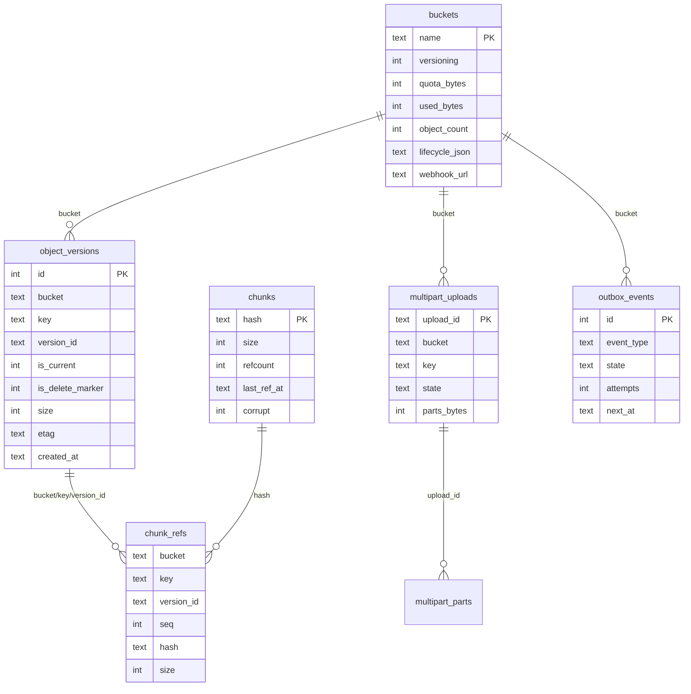
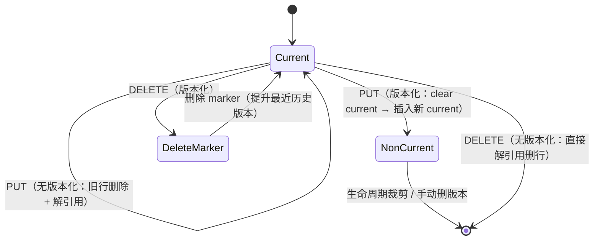
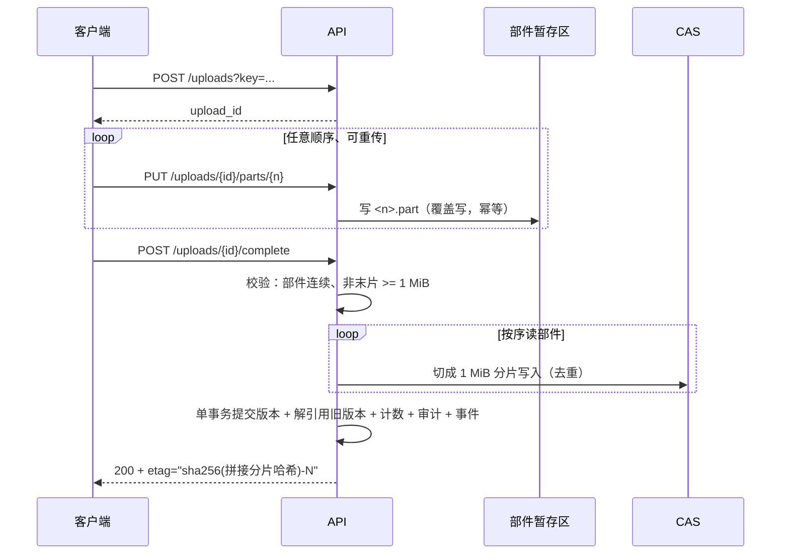
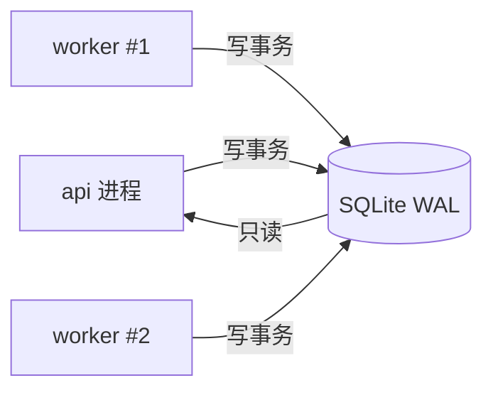

# Stratum 架构说明

本文记录 Stratum 的设计推演过程：为什么这样分层、为什么采用这些数据结构、以及每一处取舍的代价在哪里。
面向的读者是要在这个代码库上继续演进的人，而不是只想跑起来的用户（那部分看 README）。

---

## 1. 目标与非目标

**目标**

1. 单机零依赖可运行（一个 Python 进程 + 一个数据目录），便于私有化交付与本地排障。
2. 存储成本与"内容重复度"挂钩，而不是与"上传次数"挂钩。
3. 删除/覆盖不影响读；物理回收可以慢，但不能错删在用数据。
4. 元数据与正文的边界清晰到可以各自替换（换 PG / 换 S3 / 换对象网关）。
5. 后台自愈能力：计数器漂移、磁盘损坏、投递失败都能被检测并修正。

**非目标**

1. 不做 S3 全量兼容（ACL、对象锁、Select、多段 ETag 语义均不实现）。
2. 不做多节点共识（无 Raft、无分布式锁），扩容路径是"换元数据后端 + 分片键"，不是"加节点自愈"。
3. 不做冷热分层的真实迁移（策略字段已预留 `storage_class`，但只做标记不搬迁）。

---

## 2. 数据模型



三个"权威 / 缓存"关系值得单独记住：

| 数据 | 权威来源 | 缓存 | 修正手段 |
| --- | --- | --- | --- |
| 分片被谁引用 | `chunk_refs` | `chunks.refcount` | `maintenance.reconcile()` |
| 桶用了多少空间 | `object_versions.size` 求和 | `buckets.used_bytes` | 同上 |
| 有没有当前版本 | `object_versions.is_current` | —— | 部分唯一索引从结构上保证 |

**为什么坚持冗余计数**：删除一个 1 GB 对象若每次都反查 `chunk_refs` 做聚合，代价是 O(分片数)；
而 `refcount` 让删除变成一次 `UPDATE`。代价是可能漂移，所以必须有 `reconcile`——这是
"用可修复的冗余换热路径性能"的典型交易，前提是**冗余必须可被独立校验**。

---

## 3. 写入路径

### 3.1 为什么分两阶段

```
阶段 A（无锁）：读策略 → 预检条件 → 逐片写 CAS → 算出 size/etag
阶段 B（短事务）：复核条件 → 解引用旧版本 → 插版本 → 插分片引用 → 计数/配额 → 审计 → Outbox
```

如果把 CAS 写入放进事务里，一个 100 MB 上传会持写锁数秒，整个存储的写吞吐会退化成"一分钟十几个"。
分两阶段的代价是：阶段 A 产生的分片在阶段 B 失败时会变成垃圾。因此**必须**有 GC，
且 GC 必须足够保守（见 §6）。

### 3.2 条件写在事务内二次校验

`If-Match` / `If-None-Match` 的第一次校验只是为了"早失败"（省掉整段 IO 与磁盘写）：

```
读当前版本 → 校验（失败则 400/412，不写任何字节）
...写 CAS...
BEGIN IMMEDIATE → 重新读当前版本 → 再校验一次（失败则 ROLLBACK）
```

第二次校验是正确性保证：两个并发 `If-None-Match: *` 只有一个能进事务并提交。
实测 6 并发抢写同一个 key，结果恰好 1 个 200、5 个 412（`test_parallel_conditional_put_only_one_wins`）。

### 3.3 版本化 / 非版本化的分支



关键不变量由 DB 保证：`CREATE UNIQUE INDEX ux_versions_current ON object_versions(bucket,key) WHERE is_current=1`。
应用层忘记 `clear_current` 会直接触发唯一约束失败，而不是静默产生两个"当前版本"。

---

## 4. 读路径与 Range

`open_object()` 先做三件事，全部在返回响应体之前完成：

1. 取版本元数据；若是删除标记 → `404 NoSuchKey`（带 `delete_marker` 提示）；
2. 取该版本的分片序列，逐片检查**元数据存在、未标记 corrupt、文件存在**；
3. 用 `Range` 头解出 `[start, end]`。

提前检查的动机：HTTP 响应头一旦发出就无法改状态码。若等到流式读时才发现分片缺失，
客户端只会收到一个被截断的 200 —— 那比 500 危险得多。因此宁可先付 N 次 `stat`。

Range 计算按分片偏移：

```
chunk_i 覆盖 [offset_i, offset_i + size_i - 1]
与本区间求交 → 对 CAS 文件做 seek + 定长读
```

支持 `bytes=a-b`、`bytes=a-`、`bytes=-n`；越界返回 416 并带 `Content-Range: bytes */total`。

---

## 5. 分片上传



**为什么部件不直接写 CAS**：部件可被同名覆盖、可乱序、可放弃，这与"内容寻址不可变"冲突。
分开之后，两个粒度也解耦了：客户端可以传 8 MiB 的大部件，服务端仍然按 1 MiB 落分片。

**幂等**：`complete` 是重试高发点。版本化桶里直接让 `version_id = upload_id`，
重复调用命中"已提交"分支后返回同一版本（`idempotent_replay: true`），不会产生重复对象。

**最小片大小**：非末片必须 ≥ 1 MiB（等于分片大小）。这条约束的现实意义是防止
"客户端把 100 MB 拆成 1 万个 10 KB 部件"，把元数据表撑爆。末片可小，否则整除场景无法收尾。

---

## 6. GC 的竞态与宽限期

删除一个版本 = `refcount -= n`，物理文件不动。真正的删除在 GC：

```
候选：refcount <= 0 AND last_ref_at < now - grace
事务内复核：refcount 仍 <= 0，且 chunk_refs 里确实没有引用（权威校验）
提交后：再 unlink 文件
```

**为什么先删元数据、后删文件**：反序会在崩溃窗口里留下"有元数据、没文件"的坏对象；
正序只会留下"没元数据、有文件"的孤儿，孤儿不伤害读路径，可被 `orphans` 扫描发现。

**竞态分析**：极端场景是——GC 判定某分片无引用后，一个正在上传的请求恰好要复用这个分片：

```
T1 上传：CAS.put(chunk) → 文件已存在 → 归为"去重命中"，不写盘
T2 GC  ：判无引用 → 删元数据行 → unlink 文件
T1 提交：inc_refcount → 引用了一个已不存在的文件 → 读时 500
```

两道防线：

1. **宽限期**（默认 900 s）远大于单次上传耗时，候选必须是"很久没被引用"的分片；
2. **事务内复核** `chunk_refs`，而不是只信 `refcount`。

诚实地说：把宽限期调成 0 并高并发制造上述时序，理论上仍可复现。这是"非分布式事务下的最优近似"，
真实系统（如 JuiceFS、MinIO）用的是同一套思路。彻底解决需要 CAS 侧引入"写入租约"，代价是复杂度陡增。

---

## 7. 后台进程模型

`api` 与 `worker` 是两个进程，共享同一个数据目录：

* 通过 **WAL** 允许"一写多读"并发，二者互不阻塞（除写锁短暂排队）；
* 通过 **Outbox 租约** 实现互斥：`UPDATE ... WHERE id=? AND state='PENDING' AND next_at=?`
  是 CAS，抢不到就跳过。因此可以安全地起多个 worker；
* `busy_timeout=15s` 兜住瞬时锁冲突，避免 `database is locked` 直接冒到用户。



这是"用单机原语模拟分布式协作"的取舍：省掉 Redis/MQ，换来"只能共享同一数据目录"的限制。
容器部署时把数据目录挂成同一个具名卷即可。

---

## 8. 容量模型

设对象大小 `S`，分片 `C = 1 MiB`：

```
分片数 n = ceil(S / C)
CAS 占用 ≈ S                       （最后一片可能不满，向上取整到片）
元数据 ≈ 每个版本 1 行 + n 行 chunk_refs
去重后占用 ≈ 唯一内容集合的大小
```

实际测量（压测脚本写入 1854 个 64 KiB 对象，源自 32 份不同内容）：

| 指标 | 值 |
| --- | --- |
| 逻辑容量 | 120.7 MiB |
| 物理分片 | 44 个 / 6.8 MiB |
| 去重收益 | 94% |

小文件场景的放大点在元数据而非正文：每个对象至少 1 行版本 + 1 行引用（约 300 B）。
如果把 64 KiB 对象改成 4 KiB，元数据占比会显著上升——这也是 §15 里"冷分片打包"要解决的问题。

---

## 9. 并发与事务策略

| 决策 | 说明 |
| --- | --- |
| `BEGIN IMMEDIATE` | 立即取写锁。避免"先读后写升级锁"在 SQLite 下必然失败（`SQLITE_BUSY_SNAPSHOT`） |
| 写事务只包元数据 | 正文写入、etag 计算、部件读盘都在事务外 |
| 单层事务 | 连接按线程复用后不允许嵌套 `tx()`；服务层每个用例只开一层 |
| 配额在 UPDATE 里判断 | `WHERE quota=0 OR used+delta<=quota`，把 CAS 交给数据库写锁 |
| 唯一索引兜底不变量 | 单 current 版本、单分片一行、Outbox 主键自增 |

**连接复用**的实测收益：单次 PUT 从 ~20 ms 降到 ~3 ms（p50），吞吐从 70 rps 涨到 301 rps。
原因是 Windows 上每次 `sqlite3.connect` 都要重放 4 条 PRAGMA（约 1 ms），而一次 PUT 原本要建 3 次连接。

---

## 10. 错误模型

| HTTP | code | 触发点 |
| --- | --- | --- |
| 400 | `InvalidRequest` | 参数/JSON/键格式/生命周期字段非法 |
| 401 | `Unauthorized` | 无凭证、令牌错误、密钥吊销 |
| 403 | `AccessDenied` | 作用域不足、签名不匹配、预签名过期 |
| 404 | `NoSuchBucket` / `NoSuchKey` / `NoSuchUpload` | 资源不存在或被删除标记覆盖 |
| 409 | `Conflict` | 桶重名、桶非空、上传状态非法 |
| 412 | `PreconditionFailed` | `If-Match` / `If-None-Match` 不满足 |
| 413 | `EntityTooLarge` | 超过对象大小上限 |
| 416 | `InvalidRange` | Range 越界（带 `Content-Range: bytes */size`） |
| 500 | `ChunkCorrupted` | 分片缺失/哈希不符/被标记损坏 |
| 507 | `QuotaExceeded` | 桶配额不足 |

所有错误体结构一致：`{"error": {"code", "message", "detail", "request_id"}}`，
`request_id` 与日志、审计里的同名字段可串联。

---

## 11. 扩展点

| 想做的事 | 改哪里 | 注意 |
| --- | --- | --- |
| 元数据换 PostgreSQL | `stratum/storage/metadata.py`（唯一 SQL 出口）+ `db.py` | 把 `BEGIN IMMEDIATE` 换成 `SELECT ... FOR UPDATE` 或乐观版本号；`?` 占位符换 `%s` |
| 正文换 S3/OSS | `stratum/storage/cas.py` 实现同一接口（put/read/iter_range/delete/exists） | `iter_range` 必须支持字节偏移，否则 Range 失效 |
| 加冷热分层 | `storage_class` 字段 + 生命周期里的新规则 | 分片是共享的，按对象分层会导致同一分片被多个层级引用，需先做"引用分组" |
| 加桶级限流 | `api/deps.py` 增加令牌桶 | 注意分布式场景需要共享计数（Redis），当前架构是单机 |
| 接消费端 | `outbox_events` 已含 payload；新增 `sender` 实现即可 | 至少一次语义，消费端按 `id` 去重 |

---

## 12. 压测方法与瓶颈定位

```bash
python scripts/bench.py --base-url http://127.0.0.1:8080 --token change-me \
  --bucket bench --size 65536 --concurrency 8 --seconds 6
```

定位过程（记录一下，避免后来者重复踩）：

1. 首轮 PUT 只有 70 rps、p50 95 ms —— 先怀疑 `fsync`，关掉后无变化（`STRATUM_FSYNC_CHUNKS=0` 实测一致）；
2. 单请求串行实测 20 ms，8 并发只跑到 70 rps，说明请求没有真正并行 —— 指向**每次请求建 3 次 SQLite 连接**；
3. 改成线程内复用连接后，p50 从 95 ms 降到 2.6 ms，吞吐 301 rps；
4. 继续加并发（16/32）吞吐不升，p99 长尾拉长 —— 写锁串行 + WAL checkpoint，这是单库上限；
5. GET 不受写锁影响，566 rps / p99 26 ms，符合"读并发好"的预期。

结论写在 README 的性能章节：**301 rps 是 SQLite 的物理上限，不是架构上限**。
